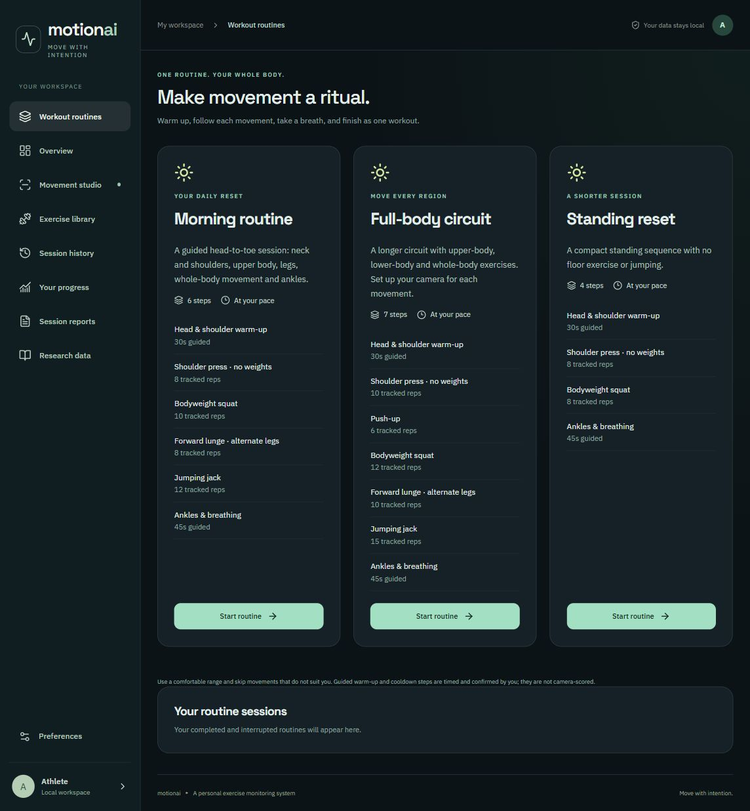
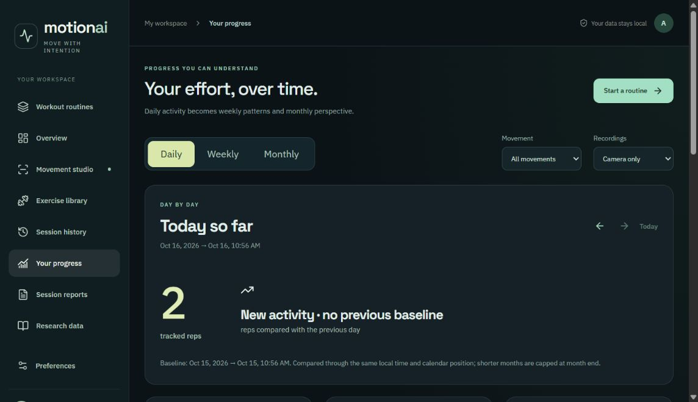

# MotionAI — Personal Exercise Monitoring System

## Workspace update · October 20, 2026

The app now includes accounts, first-time setup, a redesigned Home/sidebar, tolerant movement-cycle counting, readable exercise/routine reports, day/week/month progress, detailed CSV exports, validated JSON backup/import, FAQs and an optional contextual AI assistant.

Start with `INSTALL.bat`, then `START_APP.bat`. Create a username/password account, save the recovery code, and sign in. Google sign-in and the AI assistant require your optional provider credentials in `.env`; see `.env.example`.

Read [the current implementation and setup notes](docs/IMPLEMENTATION.md) and [current verification results](docs/VERIFICATION_CURRENT.md). Older documentation and screenshots below describe the earlier version.


A dark-themed exercise monitoring app with live joint tracking, automatic rep counting, guided workout routines, local progress analysis and real MotionBERT 3D pose inference.

## App preview

### Workout routines


### Daily, weekly and monthly progress


## Features

- **Live movement studio:** camera preview, 33-joint skeleton overlay, joint angles, positioning feedback and an animated side-by-side exercise demo.
- **Automatic rep counting:** complete movement cycles for squats, lunges, push-ups, jumping jacks and shoulder presses. Uncertain tracking pauses counting.
- **Guided routines:** Morning Routine, Full-body Circuit and Standing Reset. Tracked exercises can open the camera automatically; reaching the rep target saves the step and starts a rest break. Warm-up/cooldown steps use clearly labelled, self-reported timers.
- **Routine recovery:** resume unfinished routines, retain partial sets and view all their individual movement reports. One finished routine counts as one workout toward the weekly goal.
- **Progress analysis:** daily, weekly and monthly totals, matched-period percentage comparisons, active days and per-exercise filtering. No invented percentage when there is no previous baseline.
- **MotionBERT analysis:** official pretrained MotionBERT-Lite / DSTformer lifts recorded 2D joints into estimated 3D poses for interactive replay and range-of-motion reports.
- **Local storage:** SQLite history, JSON recording import/export, CSV history export and printable reports. Camera video is not uploaded.
- **Optional research explorer:** IntelliRehabDS catalogue, original Kinect skeleton replay and exploratory MotionBERT analysis when the separately downloaded dataset is installed.

## Run on Windows

Install **Python 3.11+ (64-bit)** and **Node.js 22+**. Enable Python in PATH.

1. Clone or download this repository and extract it.
2. Double-click `INSTALL.bat`. Internet access is required to install dependencies and download the camera model and MotionBERT checkpoint.
3. Double-click `START_APP.bat`.
4. Open **http://localhost:3000/**. Keep the launcher window open; it may be minimized.

Opening localhost alone does not start the server. Run `START_APP.bat` again after restarting your computer. Allow camera access when prompted. MotionBERT may take a little longer to load than the interface.

### Manual setup (Windows, macOS or Linux)

```sh
python -m venv .venv
# Windows: .venv\Scripts\activate
# macOS/Linux: source .venv/bin/activate
python -m pip install -r requirements.txt
npm ci
python scripts/download_assets.py
python scripts/download_checkpoint.py
npm run build
python -m backend.launch
```

The build copies the MediaPipe WASM runtime from the locked npm package. Camera assets and the MotionBERT checkpoint are downloaded from their upstream hosts and checked against recorded SHA-256 hashes. They are not stored in Git.

## How to use

1. Choose **Workout routines** for a complete session, or **Movement studio** for one exercise.
2. Follow the positioning cue and keep the required joints visible. The app counts a start → target → return cycle.
3. Routine movements save at their target; use **Finish & save** for a partial set. The camera turns off during rest and guided steps.
4. Open a saved movement report and choose **Analyze with MotionBERT** for estimated 3D replay.
5. Open **Your progress** to compare days, weeks or months. Current periods use matching local calendar positions and times; older periods compare complete calendar periods.

## Architecture

```text
Camera → MediaPipe worker → joint measurements → rep counter → SQLite recording
                                             ↓
                                   routine step / progress totals

Saved 2D joints → H36M adapter → MotionBERT-Lite → 3D replay and measurements
```

- Frontend: React, TypeScript, Three.js, MediaPipe Tasks Vision, Lucide icons.
- Backend: Python, FastAPI, NumPy, PyTorch, SQLite.
- Build: Rollup. API documentation: http://localhost:3000/docs while running.

## Research dataset (optional)

Download `SkeletonData.zip` from the [IntelliRehabDS release](https://zenodo.org/records/4610859) and place it in `data/SkeletonData.zip`. Expected MD5: `c243bcdbd1492e4928032e158accdd29`.

The supplied release contains 2,589 paired recordings and 30 subject IDs, including a partial subject; the original paper describes 29 participants. Original researcher annotations are retained. The nine rehabilitation gestures are separate from the five live workout exercises. The app does not claim to have trained a correctness classifier on these data.

Reference: Miron et al., *IntelliRehabDS (IRDS)—A Dataset of Physical Rehabilitation Movements*, Data 2021, 6(5), 46. [Paper](https://doi.org/10.3390/data6050046). Dataset license: CC BY 4.0.

## Tests

After completing setup:

```sh
npm run lint
npm test
python -m unittest tests.test_api tests.test_launch tests.test_routines.RoutineTests -v
# Requires the optional dataset:
python -m unittest tests.test_dataset -v
```

Tests cover generated movement trajectories, camera cleanup/recovery, routine auto-save, saved routine persistence, partial results, period comparisons, launcher checks and real checkpoint inference. Generated landmarks and mocked camera tests are not measurements of real-world recognition accuracy.

## Privacy and limitations

Personal recordings, SQLite databases, local runtime paths, virtual environments, dependencies, generated builds and downloaded models/datasets are excluded from this repository. Your app creates `data/motionai.sqlite` locally. Back it up if you want to preserve your sessions.

Exercise selection is user-driven. Repetition counting and coaching use explicit rules; MotionBERT performs 3D pose lifting, not technique classification. Joint coordinates and angles are estimates. Percentage changes describe recorded activity volume, not improvements in fitness or medical outcomes. Lighting, framing, occlusion and camera angle affect tracking. The app has not been clinically validated or certified for app-store release.

## Project documentation and attribution

- [Routine flow and comparison methodology](docs/ROUTINES_AND_PROGRESS.md)
- [Model provenance](docs/MODEL_PROVENANCE.md)
- [Architecture](docs/ARCHITECTURE.md)
- [Third-party notices](docs/THIRD_PARTY_NOTICES.md)
- [MotionBERT upstream Apache-2.0 license](docs/MotionBERT-LICENSE.txt)

MotionBERT: Zhu et al., *MotionBERT: A Unified Perspective on Learning Human Motion Representations*, ICCV 2023. [Upstream project](https://github.com/Walter0807/MotionBERT).
